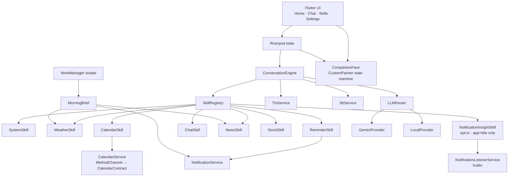

# Architecture

## Layers



## Request lifecycle

1. `SttService` (or the text field) emits an utterance.
2. `ConversationEngine.classify()` picks a skill using cheap intent patterns first, then the LLM
   for ambiguous input (returns a JSON intent when a key is configured).
3. The skill receives a `SkillRequest` and returns a `SkillResponse` (text + optional data +
   suggested face state).
4. The engine asks `TtsService` to speak the response and sets the face state to `speaking`,
   then back to `idle`.
5. The utterance and reply are appended to chat history (Hive).

Skills never touch UI, notifications, or TTS directly. They receive a `SkillContext` with
narrow capabilities (`speak`, `notify`, `now`, `settings`) so they stay testable and
permission-scoped.

## Skill contract

```dart
abstract class Skill {
  String get id;
  String get displayName;
  SkillManifest get manifest;
  Future<void> init(SkillContext ctx);
  Future<SkillResponse> invoke(SkillRequest req);
  Stream<SkillEvent> get events;      // proactive pushes
  Widget? buildSettings(BuildContext context);
}
```

Registration is one line in `SkillRegistry.bootstrap()`; enabling/disabling is a settings flag
resolved by the registry. Adding a skill requires no other file changes (proved by
`docs/skill-authoring.md`).

## Background model

Android 13+ makes always-on microphone services fragile and battery-hostile. PixelCompanion
therefore uses:

- **WorkManager** one-off task chained daily for the morning brief (survives reboot).
- **WorkManager** periodic task (15 min minimum) for stock threshold checks, only when enabled.
- A normal ongoing notification while the companion is "awake" (no hidden FGS).
- Push-to-talk in the foreground; optional continuous listening is documented as a trade-off.

The background isolate re-reads settings from `SharedPreferences` and uses `dio` directly; it
does not depend on Riverpod or UI state.

## Data

| Data | Store | Why |
|---|---|---|
| Settings (keys, city, watchlist, toggles) | `SharedPreferences` JSON | readable from the WorkManager isolate |
| Chat history, skill logs | Hive box | append-heavy, local-only |
| API key | `flutter_secure_storage` (Keystore) | never in plain prefs |
| Calendar | system CalendarProvider | no duplicate source of truth |

All cloud calls go through `NetworkLog`, capped at 200 entries, surfaced in Settings.
